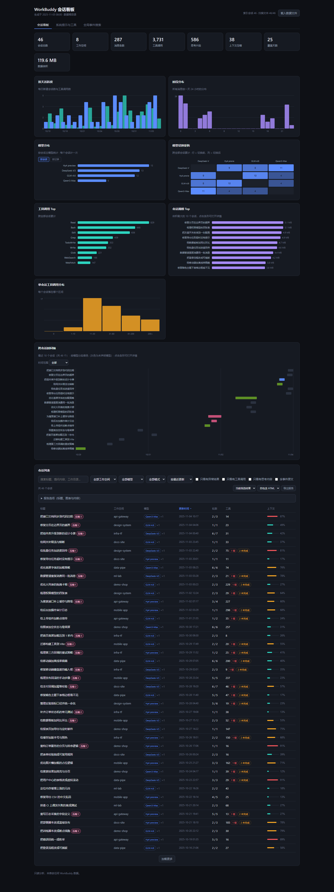
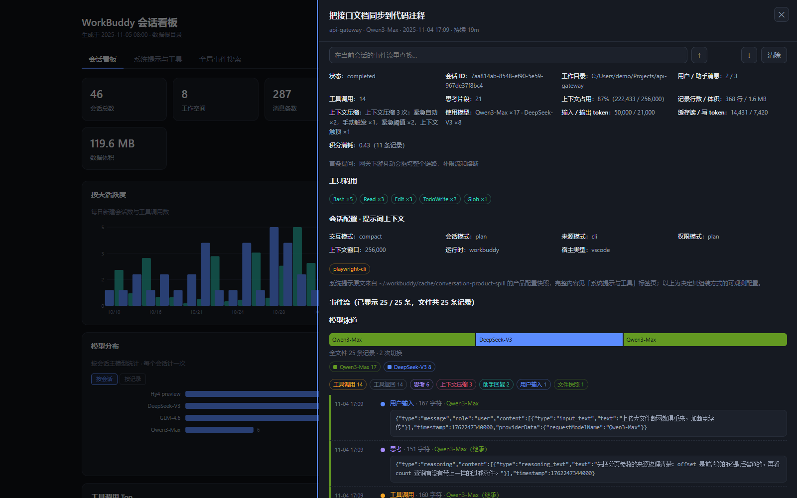
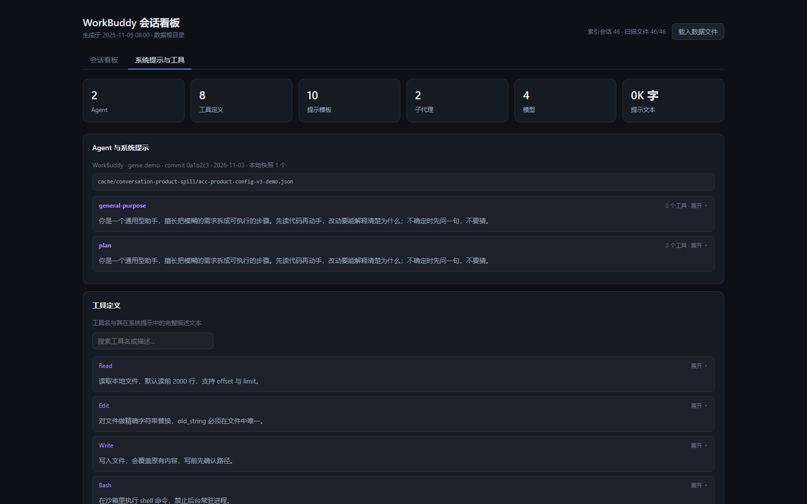

# WorkBuddy 会话看板

在线地址：**https://shenyunhang.github.io/workbuddy-session-visualization/**

一个用于查看本机 WorkBuddy 会话记录的看板页面，纯静态、零依赖、零数据、零后端。

## 这个页面不含任何数据

仓库里只有一个静态 HTML 页面（外加本说明用到的几张截图），**没有、也永远不会包含**任何会话内容、
思考原文、工具输出、文件路径、系统用户名或凭据，也没有任何扫描脚本或后端代码。
数据始终留在使用者自己的机器上。

## 使用方式：选中 ~/.workbuddy 目录即可

1. 用 **Chrome / Edge** 打开页面。页面会按 `navigator` 判断系统并直接显示默认目录
   （Windows `C:\Users\<你>\.workbuddy`、macOS `/Users/<你>/.workbuddy`、Linux `/home/<你>/.workbuddy`），
   点「**打开并选择 WorkBuddy 目录**」选中它即可。
   - **更快的两条捷径**：点「复制可粘贴路径」拿到 `%USERPROFILE%\.workbuddy`（macOS/Linux 为 `~/.workbuddy`），
     在文件夹对话框的地址栏粘贴即直达；也可以直接选中**你的用户目录**，页面会自动往下进 `.workbuddy`。
   - 第二次访问时按钮会变成「**继续访问上次的 WorkBuddy 目录**」——浏览器记住了上次授权的目录句柄
     （存在浏览器自己的 IndexedDB 里，只有句柄，不保存用户名），点一下无需再导航。
2. 目录选择器只走进 `projects/` 和 `cache/conversation-product-spill/` 两个子目录 —— 整个
   `~/.workbuddy` 常常有十几万个文件、好几个 GB，全量枚举会让标签页在解析开始前就卡死。
   直接把目录拖进页面也有同样的保护：跳过 `binaries/`、`plugins/`、`logs/` 等大目录，
   `cache/` 只进入产品配置快照目录，且总共最多收集 5000 个文件。
3. 页面在浏览器里完成全部解析：
   - `projects/<workspace>/<session>.jsonl` → 会话记录、事件流、工具与模型统计
   - `cache/conversation-product-spill/*.json` → 系统提示、agent 指令、工具说明
   - 默认解析最新的 100 个会话文件、最多读 1024 MB（会话文件动辄几 MB，页面上都能改）
   - 解析期间有进度条，并且**每解析完一批就立刻把会话画出来**；随时可以「停止解析」，已解析的会话保留
   - 扫描器只对少数几种小记录做完整 `JSON.parse`；占体积 96% 的工具调用/工具返回/文件快照/思考记录，
     只从原文前 1.5 KB 里正则抽取需要的字段（实测 104 MB 从 5.6 s 降到 3.2 s）
   - **原始 JSON 默认不截断**：「每会话原始 JSON 预算」默认 `0`，即事件流里每条记录都保留完整原文，
     不会出现「已截断」。想要更小的内存占用，把它改成一个正数（如 `20000`）即可按会话限额截断
   - 展开超大记录时只对前 64 KB 做语法高亮、最多 1200 个着色片段，其余以纯文本输出：
     全文依然完整可见，但不会为上万个 JSON token 各建一个 DOM 节点把页面卡住
     （684 KB 记录实测从 80000 个片段降到 1200 个）

**不需要跑任何脚本、不需要开服务、不上传任何文件**：文件读取和解析全部由浏览器的
File API 完成，刷新页面即回到无数据状态。

## 页面能看到什么

会话列表与筛选（表头和下拉都支持按标题、工作空间、模型等字段排序；**再点一次同一表头可切换升降序**，
箭头与 `aria-sort` 同步；下拉里还可按异常结果数排序）、按天活跃度、时段分布、
模型分布（可切换**按会话**或**按记录**统计，前者每个会话只算主模型，后者把会话里切换过的每个模型都计入）、
工具调用 Top、会话规模 Top（体积最大的会话，点条形可直接打开详情）、单会话工具调用分布、
每个会话的完整事件流（直接渲染原始 JSON 记录，不做字段提取；每次渲染 100 条），
以及「系统提示与工具」标签页里的 agent 指令、工具说明与全部提示模板。

**一次对话里换了模型也能看出来**：详情面板会显示「使用模型」构成，事件流上方有一条
**模型泳道**，按全文件记录顺序把同一模型的连续区间画成一个色段，标出切换次数；
下方图例列出各模型处理的记录数，点图例或色段可只看该模型的事件，事件行左侧也有同色细条。
没有显式模型字段的记录（用户消息、普通回复等）会继承上一个已知模型，并在事件行标注「继承」；
泳道用的是全文件统计，不受 210 条事件上限影响。颜色由模型名哈希决定，筛选后不会串色。
会话列表的模型标签会带 `+N` 表示还用了几个其他模型。

详情面板顶部有独立的「**在当前会话的事件流里查找**」输入框，只过滤当前会话已载入的事件。
命中处会用高亮标出，预览窗口会自动移到命中位置附近（即使它远在记录的前 240 字符之外），
点「展开完整 JSON」后全文里的命中同样保留高亮且与语法着色共存，
标题显示匹配条数；搜索框是静态的，输入过程不会因列表重绘而丢失焦点，切换会话时自动清空。
输入框旁的 **↑ / ↓** 按钮（或 `Enter` / `Shift+Enter`）可在多个匹配之间循环跳转，
中间显示「第几个 / 共几个」；当前命中会整行高亮并自动滚到可见位置，
即使它超出当前分页也会自动扩展分页。
搜索与上方的事件类型标签由同一套渲染逻辑处理，匹配条数不会把已隐藏的类型算进去。
搜索范围只覆盖当前已载入的记录，磁盘上尚未解析的部分需先点「从文件继续解析」。

搜索默认只匹配标题、首条提问、工作目录和模型。勾选「**含事件原文**」后也会匹配事件流里的
原始 JSON，用来定位某次工具调用里的路径或报错文本；因为原始记录可能很大，它默认关闭、
输入停下后才执行、查询至少 2 个字符、同一查询结果会缓存，并且单个会话最多扫描 16 MB，
超上限时列表会提示「原文搜索已达扫描上限」。

页面支持键盘操作：`Tab` 可到达表格行、排序表头、事件类型标签、展开按钮和折叠标题，
`Enter` / `Space` 激活，`Esc` 关闭详情面板并把焦点还给打开它的位置；详情面板以
`role="dialog"` 标记，打开时焦点移入、关闭时恢复，且有独立的关闭按钮。

事件流有两层「更多」，含义不同：
- 「**显示更多已解析事件**」只翻页当前已经载入内存的记录，不读磁盘。
- 「**从文件继续解析**」把首轮 210 条之后的记录追加进来；括号内是精确剩余条数。
  首次解析其实已经读完整个文件并算完全部统计，只是没有为超出上限的记录生成事件，
  因此页面会缓存行文本和这些记录的索引，续解析**不再重新读取或重新扫描会话文件**
  （实测 2 万行 / 3.5 MB 的会话连点 5 次，CPU 从 228 ms 降到 6 ms）。
  没有时间戳的记录会照常保留、标注「时间未知」，不会被误算成「还没解析」。
  翻页或续解析时，已经展开的 JSON 与已隐藏的事件类型会保持原样，只有切换到另一个会话才重置。

> 「会话状态」「上下文占用」这类字段只存在于 `workbuddy.db`，浏览器模式不读数据库，因此显示为「—」；
> 详情面板会改用请求里带的 `prompt_tokens` 峰值，补一行「输入 token 峰值」。

> 下面三张截图用的是**完全虚构的演示数据**（会话标题、工作目录、消息、工具调用全部是编的，
> 路径形如 `C:/Users/demo/Projects/...`），只用来展示版面，不含任何真实会话内容。

### 看板总览

### 单个会话的事件流

点开任意一行，右侧面板给出该会话的元信息与按时间排列的原始 JSON 记录。

### 系统提示与工具

从 `cache/conversation-product-spill/` 读到的产品配置：agent 指令、工具说明、提示模板。

## 已知取舍

- `workbuddy.db` 不会被读取（SQLite 需要 WASM 引擎）。因此只存在于数据库里的字段
  —— 会话状态、思考级别、权限模式、上下文窗口、已启用插件 —— 显示为「—」；
  其余指标（时间、轮次、工具调用、token、模型、工作目录、标题）都来自 JSONL，完全可用。
- 会话标题取 JSONL 里的 `ai-title`；文件里没有 `ai-title` 时回退到「首条提问」
  （已剥掉 `<system-reminder>` 等注入块），并在详情面板上标注「取首条提问」。
- 只有**确实被 210 条上限截断**的会话才会额外保留行文本用于快速续解析，缓存总量上限 256 MB；
  超出上限的会话自动回退到按需重读文件，功能完全一致，只是稍慢。未截断的会话不占这份内存。
- 模型泳道依赖逐条记录里的 `requestModelName` / `model` 字段。若载入的是旧版 `data.json`
  快照或不含这些字段的记录，页面会降级成「按记录数占比」色条并明确标注无法还原切换顺序。
  模型字段只从每条记录前 1.5 KB 提取，因此正文被预算截断也不影响。切换段最多保留 100 段并会提示。
- 工具结果的 `status` 按四类处理（大小写不敏感）：`completed / success / ok` 为正常；
  `error / failed / failure / exception / timeout / cancelled …` 记为「报错」；
  `incomplete / partial / truncated / interrupted` 记为「未完成」；
  其他非空值记为「状态未识别」并列出具体值，**不再静默算作报错**，也不缺失字段。
  快路径（记录前 1.5 KB 正则）与完整 `JSON.parse` 回退共用同一套分类，
  「只看有异常结果」筛选覆盖后三类。
- `toolCalls` 数的是 `function_call` 记录，`toolErrors` / `toolIncomplete` 数的是
  `function_call_result` 记录。两者现在会额外按 `callId` 配对，在有该字段的记录里
  单独显示「调用未收到结果」次数；没有 `callId` 的旧快照不受影响。
  因此「N 次调用 · M 次报错」仍应读作两个独立口径，但缺结果的情况已可见。
- 工具结果除 `status` 外也兼容 `is_error` / `isError` 布尔字段（映射到报错 / 完成）。
- 三个解析上限输入框（最多文件数 / 原文预算 / 体积上限）由同一组默认值
  `100 / 0 / 1024` 驱动：清空输入框时不会再静默变成另一组上限。
  文件读取失败时，状态栏会给出最近一次失败的文件名与原因，控制台也有详细日志。
- **本仓库只有一个页面，不含任何扫描脚本**。解析全部在浏览器里完成，也就不需要
  先在本机跑脚本、更不会生成任何中间文件。如果你手上已经有一份 `data.json` 快照
  （结构同页面内嵌的数据），可以直接拖进页面载入。

## 隐私说明

- 数据不上传：页面是纯前端的，只读取你主动选中的本地文件
- 路径脱敏：本机 home 目录与系统用户名在显示时自动替换为 `~` / `<user>`；会话记录原文、工具与模型名称、
  工作目录、标题，以及「系统提示与工具」里的整段提示模板都会经过同一套脱敏，截图也不会泄露
- 本仓库不含任何个人数据，可安全公开

## 开发验证

源码仓库里保留三套回归测试，模板改动后应全部跑通：

- `node smoke-test.js`：模板语法、静态隐私扫描、纯逻辑与渲染字符串断言（Node VM + DOM 桩）
- `node browser-test.js`：浏览器侧解析、缓存续解析、目录选择、拖放保护等流程（Node VM + DOM 桩）
- `python real-browser-test.py`：**真实浏览器**端到端验收，覆盖 `innerHTML` 解析、焦点移交、
  滚动、aria 状态与事件冒泡；默认 Chromium，`--browser firefox|webkit|all` 可切换引擎
  （需 `python -m playwright install firefox webkit`），`WB_CHROME` 可指定 Chromium 路径
- `python performance-profile.py`：用完全合成的大规模会话（约 15 MB / 3 万条记录 + 60 个中等会话）
  在真实浏览器里剖析载入、续解析、翻页、搜索与渲染耗时，不读取任何真实用户数据
- `python behavior-snapshot.py --save` / `--compare`：导出真实浏览器里列表、图表、抽屉、提示页以及
  筛选/搜索/排序后的关键 DOM 输出并逐字节比对，另外比对两处截图哈希作为视觉基线，
  用来证明重构没有改变外部行为。演示数据的时钟可用 `WB_DEMO_NOW` 固定，保证基线可复现

`python demo_gen.py` 用虚构数据生成演示页（真实浏览器测试加载它），
`python build.py` 从模板重建这份不含数据的部署页。两个 Python 脚本会在演示页比模板旧时自动重新生成。
